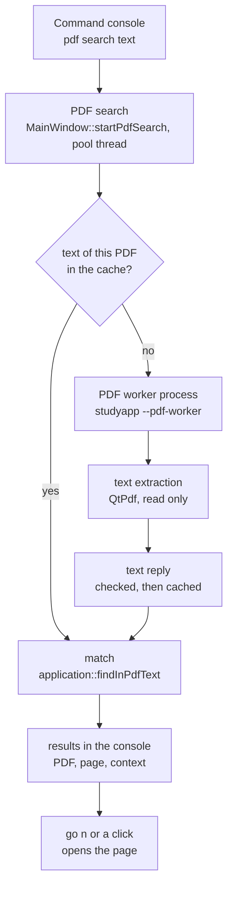

# StudyBoard — Command Console

> **Status: implemented in 1.2** (tasks 1.2-CMD-01 and 1.2-CMD-03; decisions
> [D54, D55 and D56](ARCHITECTURE.md#18-decision-log)). PDF text extraction is specified in
> [PDF_WORKER.md §23](PDF_WORKER.md#23-text-extraction).

The command console is a small panel in which StudyBoard commands are typed instead of
clicked: open a page by its title, search, import and export, look at the workspace's
state, search the **text inside imported PDFs**, and export a whole notebook in the
background. It is another way to reach operations StudyBoard already has, plus PDF content
search and the first batch command (§10).

It is **not** a terminal, a shell or a scripting language. A line names one registered
StudyBoard command and its arguments; nothing else can run (§8).

---

## 1. Opening and closing

| | |
|---|---|
| Open | **View ▸ Command Console**, or **Ctrl+Shift+C** (⌘⇧C on macOS) |
| Focus | The same shortcut moves the focus to the console's command line when it is open |
| Close | **Esc** in the command line, the same shortcut while the console has the focus, or the panel's close button |

The console is a panel docked at the bottom of the window (it can be moved to the top or
floated). Its visibility is remembered with the window layout. Nothing of it is built
until it is first opened.

## 2. Using it

```
> pdf search "Fourier transform"
Searching the text of 1 PDF for “Fourier transform”… (cancel stops)
PDF search: “Fourier transform”
Notebook › Lecture 05
  [1] Page 4  …the Fourier transform of a periodic signal is a sum of…
  [2] Page 8  …inverse Fourier transform recovers f from F…
2 matches in 1 PDF. Click a result or type go <n> to open its page.
```

| Key (in the command line) | Does |
|---|---|
| Enter | runs the line |
| ↑ / ↓ | previous / next command of this session (§5) |
| Tab | completes a command name (§4) |
| Ctrl+L | clears the output (also `clear`) |
| Esc | closes the console |

Lines that point somewhere — a page, a task — are **links**: click one, or type
`go <n>` with the number shown in brackets, to open it. Numbers belong to the newest list
(each command that lists results starts again at 1). The output is read-only and can be
selected and copied.

Below the command line, a hint shows the commands that match what is typed, or the usage
of the command being typed.

## 3. Syntax

```
command words  argument  "argument with spaces"
```

* Words are separated by spaces or tabs. Command names are not case-sensitive.
* Put an argument in double quotes when it contains spaces:
  `import pdf "C:\Users\me\My Lectures\05.pdf"`. Inside quotes, `\"` is a quote and `\\`
  a backslash; every other backslash is kept as written, so Windows paths need no
  escaping (only a path that *ends* in a backslash needs it doubled: `"C:\dir\\"`).
* A quoted word is always an argument, never a command name.
* A text argument (`<text…>`) takes the rest of the line: `pdf search eigen value` and
  `pdf search "eigen value"` search for the same phrase.
* A line is at most 4 096 bytes. Control characters are refused.

Errors say what is wrong and show the usage, for example
`Missing <text>. Usage: pdf search <text…>` or
`Incomplete command. Did you mean: export page pdf, export page png, …?`.

## 4. Commands

`<x>` is required, `[x]` optional, `…` takes the rest of the line. Aliases in brackets.

| Command | Does | Same as |
|---|---|---|
| `help [command…]` (`?`) | lists the commands, or explains one with examples | — |
| `list notebooks` (`notebooks`) | every notebook with its sections and pages; each line opens its first page | the navigation tree |
| `list sections` (`sections`) | every section by notebook; each opens its first page | the navigation tree |
| `list pages [all]` (`pages`) | the pages of the current section (`all`: of the workspace, by section); PDF pages show their PDF page number | the navigation tree |
| `open page <title…>` (`open`) | opens the page with this title (§4.1) | clicking it in the tree |
| `go <number>` (`open result`) | opens result *number* of the newest list | clicking the link |
| `search <text…>` (`find`) | searches page titles, text boxes and tasks (the best 50) | Edit ▸ Find |
| `pdf search <text…>` (`pdf find`) | searches the text inside the workspace's imported PDFs (§6) | — (new in 1.2) |
| `cancel` | stops a running PDF search or batch export (§10) | — |
| `workspace info` (`workspace`) | folder, access, contents, imported PDFs, save state, search index | status bar, title |
| `import pdf <path>` | imports a PDF as a new section; one undo step "Import PDF" | File ▸ Import PDF… |
| `export page pdf [path]` | exports the current page as PDF | File ▸ Export Page… |
| `export page png [path]` | … as a PNG image | File ▸ Export Page… |
| `export page svg [path]` | … as SVG | File ▸ Export Page… |
| `export section pdf [path]` | exports every page of the current section as one PDF | File ▸ Export Section as PDF… |
| `export notebook pdf <folder>` | exports every section of the current notebook into the folder, one PDF each, in the background (§10) | — (new in 1.2) |
| `undo` / `redo` | undoes / redoes the last change and names it | Edit ▸ Undo / Redo |
| `diagnostics` (`diag`) | versions, platform, workspace and save state, PDF text cache, background work, PDF worker, console limits | Help ▸ About (versions) |
| `history` | the commands entered in this session | ↑ / ↓ |
| `clear` (`cls`) | clears the output | Ctrl+L |

### 4.1 Details

* **`open page`** compares titles without regard to case. An exact title in the current
  section wins over the same title elsewhere; without an exact match, titles that start
  with the text, then titles that contain it. When several pages match, they are listed
  (numbered) instead of opening one.
* **`import pdf`** needs the full path of an existing, readable file. The import itself is
  File ▸ Import PDF's: the file is copied into the workspace, inspected by the PDF worker
  process (D53), and becomes a section in the current notebook. Errors are written in the
  console instead of a dialog. Refused in a read-only workspace.
* **`export …`** without a path opens the same file dialog as the menu command (the format
  is the one named in the command). With a path: it must be absolute, its folder must
  exist, it must lie outside the workspace folder and must not be an existing file (the
  console never overwrites without asking); a missing extension is added
  (`export page png /home/me/page` writes `page.png`); another extension is refused.
* **`export notebook pdf`** is a batch command and differs from the four above: the folder
  is required (no dialog), the work runs in the background, and existing files are never
  replaced. Its rules, messages and limits are in §10.
* **`cancel`** stops what is running in the background — a PDF search, a batch export, or
  both — and prints nothing more itself; the search or the export reports that it was
  cancelled. With nothing running it says `Nothing is running.`
* **`undo` / `redo`** run Edit ▸ Undo / Redo, so a console import is undone like a menu
  import and undo of an edit on another page shows that page first.

### 4.2 Autocomplete

Suggestions come from the command registry only: every command name and alias that starts
with the words typed so far, sorted. **Tab** completes a single suggestion (and adds a
space), or the part all suggestions share:

| Typed | Suggestions | Tab gives |
|---|---|---|
| `p` | `pages`, `pdf find`, `pdf search` | `p` (they share nothing more) |
| `pdf s` | `pdf search` | `pdf search ` |
| `exp` | `export notebook pdf`, `export page pdf`, `export page png`, `export page svg`, `export section pdf` | `export ` |
| `export n` | `export notebook pdf` | `export notebook pdf ` |
| `pdf search x` | — (past the command name: the hint shows the usage) | — |

Arguments (paths, titles) are not completed.

## 5. History

The console keeps the last **100** commands of the session, in memory only: blank lines
are not kept and a command equal to the previous one is kept once. ↑ walks back, ↓
forward; past the newest entry the line you were typing comes back. The history is never
written to the workspace or to settings; `history` lists it.

## 6. PDF content search

`pdf search <text…>` finds words and phrases **in the text of the imported PDFs
themselves** — not in annotations, page titles, file names or StudyBoard's search index.



**What is searched.** Every section that shows pages of an imported PDF. A PDF imported
twice is searched once per section, so each result opens a page of its own section.

**Matching.**
* Case is ignored — for ASCII and also Latin-1, Latin Extended-A, Greek and Cyrillic
  letters (`Übung` finds `übung`).
* Any run of whitespace, including the line breaks a PDF puts inside a sentence, counts as
  one space: `pdf search "Fourier transform"` finds "Fourier" at the end of one line and
  "transform" at the start of the next.
* Punctuation is matched as written (`f(x)`, `(FFT)`, `eigen-`); typographic quotes and
  dashes match their ASCII forms (`don't` finds `don’t`, `1-2` finds `1–2`); the ligatures
  ff fi fl ffi ffl are spelled out; soft hyphens are ignored.
* No wildcards, no regular expressions, no word stemming. A word inside a longer word is
  found (`eigenvalue` also finds `eigenvalues`).

**Results.** Grouped by PDF (shown as "Notebook › Section", the section the import
created), in workspace order; within a PDF by page, then position. Each result shows the
PDF page number and about 40 bytes of text on each side of the match on one line, cut at
word boundaries where possible. At most **50 results per PDF and 200 in all** are shown;
a note says when more were found ("search for a longer phrase").

**Navigation.** Clicking a result, or `go <n>`, opens the StudyBoard page that shows that
PDF page and reveals it in the navigation tree. If that page was deleted, the result is not
listed. The matched words are **not highlighted** on the page: StudyBoard draws PDF pages
as images and has no text layer to highlight (follow-up 1.2-CMD-02).

**Messages.**

| Situation | Console says |
|---|---|
| no PDF in the workspace | No imported PDFs in this workspace (File › Import PDF, or import pdf "<path>"). |
| nothing found | No PDF text matches found for “…”. |
| a PDF without any text (scanned pages) | … has no text layer (a scanned PDF?). |
| the worker crashed or exited | Notebook › Section: PDF search failed: the PDF could not be read (the reader stopped). |
| the worker took longer than 30 s | … PDF search failed: the PDF could not be read in time. |
| not a readable PDF, password-protected | … the file is not a readable PDF document / password-protected PDFs are not supported |
| the stored PDF file is missing | … the PDF file is missing from the workspace (File › Check Workspace lists missing files) |
| `cancel`, a new search, closing the workspace | PDF search for “…” was cancelled. (closing: nothing, the console belongs to the window) |
| empty query | pdf search: give the text to search for, … |

One PDF failing does not stop the others; StudyBoard keeps running in every case.

**One search at a time.** A new `pdf search` stops the running one; `cancel` stops it; the
status bar shows "Searching PDFs…" meanwhile. The rest of StudyBoard stays usable.

## 7. Performance and resources

* **Closed console: no cost.** Nothing is built until the console is first opened; it has
  no timers and no polling, and it does no canvas work.
* **Bounded output.** The output keeps the last **1 000** lines; the numbered targets of
  the newest list at most **500**; listing commands write at most **500** lines.
* **PDF text off the GUI thread.** Extraction runs in the PDF worker process, started from a
  pool thread of the window (the same pool as imports); matching runs on that pool thread
  too. The GUI thread only collects what to search (sections, stored file paths, job ids)
  and writes the results.
* **Each PDF is read once per workspace session.** The extracted text is kept in a cache
  per open workspace, keyed by the stored asset (content-addressed, so it never goes
  stale), at most **32 MiB** and **64 PDFs**, least recently used dropped first; a PDF
  with more text than the whole budget is not kept. The cache is dropped when the
  workspace closes; `diagnostics` shows its size and hits.
* **Bounded text.** The worker sends at most 64 KiB of text per page and 8 MiB per PDF
  (PDF_WORKER.md §23); text beyond that is not searched and the results say so.
* **Batch export off the GUI thread.** `export notebook pdf` paints and writes on a thread
  of the same pool. The GUI thread validates the folder, copies the workspace (measured,
  Release build on a Windows 11 development machine: about 1 ms for 10 000 strokes, 11 ms
  for 100 000; the points of a stroke are shared, not copied), looks up the stored files of
  the images and PDFs the pages show, and prints the lines the export sends back. One
  batch export runs at a time.
* Measured (Release, a 4-vCPU Linux container, not the reference laptop;
  docs/BENCHMARKS.md, `BM_PdfTextInWorker`, `BM_PdfTextSearch`): reading the text of a PDF
  through the worker takes 19 ms for 1 page, 71 ms for 200 pages and 0.48 s for 2 000
  pages (about 600 bytes of text per page) — once per PDF and session; scanning the cached
  text of 2 000 pages for a phrase that is nowhere takes 4.6 ms.

## 8. Safety

* **No operating-system commands.** The console never starts a program, a shell (`sh`,
  `bash`, `cmd.exe`, PowerShell) or `system()`. A line is split into words and matched
  against the registry; anything else is "Unknown command". `$(…)`, backquotes, `|`, `;`,
  `&&`, `>` and `$VAR` have no meaning: inside an argument they are plain text.
* **No scripting.** No variables, loops, pipes, substitutions or command files.
* **The same rules as the menus.** Commands call the window's existing operations and
  application services (`application::search`, `WorkspaceStructure` through the import,
  the session's undo/redo, the page exporter). Edits go Command → Patch → Workspace →
  persistence like every other edit and are undoable; read-only workspaces refuse them.
  The console reads no database and opens no PDF itself.
* **Exports write only where they are told.** `export notebook pdf` writes into the folder
  it is given, never into the workspace folder, and refuses to start when one of its files
  already exists (§10.1).
* **PDFs are parsed only by the PDF worker** (D53): `pdf search` sends the stored file's
  path to `studyapp --pdf-worker` and accepts only a valid text reply of its own job. The
  only process the feature starts is that worker, through the existing client.

## 9. What the console cannot do

* Run programs, shell commands or scripts; open files other than through `import pdf`.
* Edit page content (ink, text, shapes) or rename, move and delete items — use the canvas,
  the tree and the menus.
* Highlight matches on the PDF page; search scanned PDFs (no OCR); search with wildcards or
  regular expressions; search inside images.
* Replace existing files from `export notebook pdf`, create its target folder, ask for the
  folder in a dialog, export a notebook as images, or run two batch exports at once (§10).
* Keep its history between sessions.

## 10. Batch operations

Batch work is done by **explicit commands with a typed application API**, never by
scripts. The registry (`application::CommandRegistry`) is the foundation: a command is a
name, typed arguments, help and a handler, so a batch command is one more entry. A batch
command runs its file work off the GUI thread (the window's pool), reports progress in the
console, honours `cancel`, and makes any edit a single undoable command. A console always
works on the open workspace; commands across workspaces are not planned.

### 10.1 `export notebook pdf <folder>`

Writes **one PDF per section of the current notebook** — the notebook of the page that is
open — into `<folder>`, in notebook order. Each file is exactly what `export section pdf`
writes for that section (1.2-CMD-03, D56).

```
> export notebook pdf "C:\Users\me\Documents\Algebra"
Exporting 3 sections of “Linear Algebra” to C:\Users\me\Documents\Algebra… (cancel stops)
[1/3] Lecture notes → Lecture notes.pdf (12 pages)
[2/3] Week 2: Series → Week 2_ Series.pdf (1 page)
[3/3] Lecture notes → Lecture notes (2).pdf (4 pages)
Exported 3 of 3 sections to C:\Users\me\Documents\Algebra
```

**The folder** is one word of the command line: a path with spaces is written in quotes
(§3); `export notebook pdf /home/me/algebra` needs none. It must be given with its full
path, exist, be a folder and lie outside the workspace folder. It is not created.

**It runs in the background.** The command returns at once; the window, the canvas and the
console stay usable, the status bar shows "Exporting…", and `diagnostics` counts it
(`1 batch export`). Each section is reported when it has been written. `[i/n]` and the
number in the first line count **all** sections of the notebook, also those without pages.

**It exports the notebook as it was when the command was entered** (text being typed is
taken in first). What is drawn, typed or deleted while it runs is in the workspace and not
in the files.

**File names** come from the section titles:

* `\ / : * ? " < > |`, control characters and bytes that are not valid UTF-8 become `_`;
  leading and trailing spaces and trailing dots are removed; a title with nothing left
  becomes `Section`;
* at most 100 characters (Unicode code points) and at most 200 bytes (UTF-8) of the title
  are kept, cut between characters;
* a name whose part before the first dot is a Windows device name (`CON`, `PRN`, `AUX`,
  `NUL`, `COM1`–`COM9`, `LPT1`–`LPT9`, in any case) gets `_` after that part (`CON` →
  `CON_`, `CON.txt` → `CON_.txt`);
* then `.pdf`. Names that are equal ignoring ASCII case get ` (2)`, ` (3)`, … in notebook
  order. A section without pages takes no name.

A file name is at most 255 bytes.

**Existing files are never replaced.** If a file one of the sections would be written to
already exists, the command is refused before anything is written. The check is repeated
immediately before each section is written; a file that appeared in between fails that
section only.

**A section that cannot be written does not stop the others.** It is reported with its
title and the reason, no file is left for it, and the summary counts it. A section without
pages is skipped; that is not a failure. An image or imported PDF whose stored file is
missing does not fail its section: the pages are exported without it, as the canvas shows
them.

**`cancel`** stops the export before its next page. The sections already written stay; the
file in progress is not left behind.

**Closing the workspace, opening another one or quitting** while it runs stops it in the
same way; the close waits only until the page being painted is finished. Nothing more is
printed for the workspace that was closed.

**One at a time.** A second `export notebook pdf` while one is running is refused.

**Read-only workspaces** can be exported: exporting only reads.

**Messages.**

| Situation | Console says |
|---|---|
| started | Exporting 3 sections of “*notebook*” to *folder*… (cancel stops) |
| a section written | [1/3] *section* → *file*.pdf (12 pages) |
| a section without pages | [2/3] *section*: no pages, skipped |
| a section that failed | [2/3] *section*: not exported: *reason* (for a file that appeared meanwhile: `the file already exists`) |
| finished | Exported 3 of 3 sections to *folder* — followed by ` (1 failed)`, ` (1 skipped)` or ` (1 failed, 1 skipped)` when there are any |
| cancelled | Export cancelled: 1 of 3 sections exported to *folder* (with the same counts) |
| no workspace | export notebook pdf: no workspace is open (File › Open Workspace) |
| no page is open | export notebook pdf: open a page first (open page \<title>) |
| another export is running | export notebook pdf: an export is already running; cancel stops it |
| the folder is missing from the line | Missing \<folder>. Usage: export notebook pdf \<folder> |
| a relative path | export notebook pdf: give the full path of the folder to write into |
| the folder does not exist | export notebook pdf: the folder “*folder*” does not exist |
| the path is a file | export notebook pdf: “*path*” is not a folder |
| the folder is inside the workspace | export notebook pdf: choose a folder outside the workspace folder |
| no section of the notebook has a page | export notebook pdf: the notebook has no pages to export |
| a file is already there | export notebook pdf: “*file*.pdf” already exists in “*folder*”; nothing was exported — with several: “*file*.pdf” and 1 more file already exist in “*folder*”; nothing was exported |
| an unexpected error on the export thread | export notebook pdf: stopped by an error: … (the sections already written stay) |
| `cancel` with nothing running | Nothing is running. |

All of it is written in the console; no dialog opens.

**Limits.**

* **The length of the whole path is not checked.** A file name is at most 255 bytes, but a
  deep folder can still exceed what the system allows for a path (260 characters on
  Windows without long-path support); that section then fails with the reason the system
  gives.
* **Names that differ only in the case of non-ASCII letters, or in Unicode normalisation**
  (`Übung` and `übung`), are not numbered. On a file system that treats them as one name
  the second of them finds the first one's file and fails with `the file already exists`.
* **A file that appears between the last check and the moment the PDF is put in place** is
  replaced: the check and the final rename are two steps. The window is the time it takes
  to write one section.
* **An error of the file system during the existing-file check** (for example a folder
  that became unreadable) is reported like an existing file: `already exists`.
* **A killed process or a power failure** while a section is being written can leave a
  temporary file named like the target with a random suffix (`Notes.pdf.Ab12Cd`) in the
  folder on Windows and macOS. It is not a complete PDF and can be deleted; StudyBoard does
  not clean it up. A cancelled or failed section leaves nothing.
* **A second `cancel` while a cancelled export is still ending** (it finishes the page it
  is painting) prints `Nothing is running.` although the export has not reported its end
  yet.
* **While a section with imported PDF pages is exported**, showing other PDF pages on the
  canvas can be slower: QtPdf renders one page at a time in the whole process.
* Only PDF, only the notebook of the open page, only into an existing folder.

### 10.2 Not yet

* `export section png [folder]` — every page of the current section as images;
* `export notebook pdf` without a folder, asking for it in a dialog;
* a File menu entry for the notebook export.

## 11. Code

| Part | Where |
|---|---|
| Tokenizer, registry, help, completion, history, `runCommandLine` (Qt-free) | `src/application/{include/studyapp/application,src}/CommandConsole.*` |
| PDF text matching, sources, text cache (Qt-free) | `src/application/{include/studyapp/application,src}/PdfTextSearch.*` |
| Text request and text reply (Qt-free protocol) | `src/ipc/{include/studyapp/ipc,src}/PdfInspection.*` |
| Text extraction in the worker; reply → document text | `src/ui/src/PdfText.*`, `src/ui/src/PdfWorker.cpp` |
| Text jobs in the client | `src/ui/src/PdfInspectionClient.*` (`runPdfTextJob`, `extractPdfTextInWorker`) |
| The panel (output, command line, links, keys) | `src/ui/src/CommandConsole.*` |
| The dock, the commands, PDF search, the batch export job (`startNotebookExport`) | `src/ui/src/MainWindowConsole.cpp` |
| Batch export: file names, the plan of a notebook export, the sequential runner (Qt-free) | `src/application/{include/studyapp/application,src}/BatchExport.*` |
| Painting and writing pages, on the GUI thread or from plain data on another thread | `src/ui/src/PageExport.*` (`exportPages`, `exportAssets`, `exportTextStyle`) |

Tests: docs/TESTING.md ("1.2 additions: command console" and "1.2 additions: batch PDF
export").
