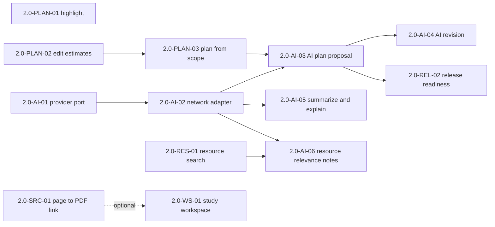
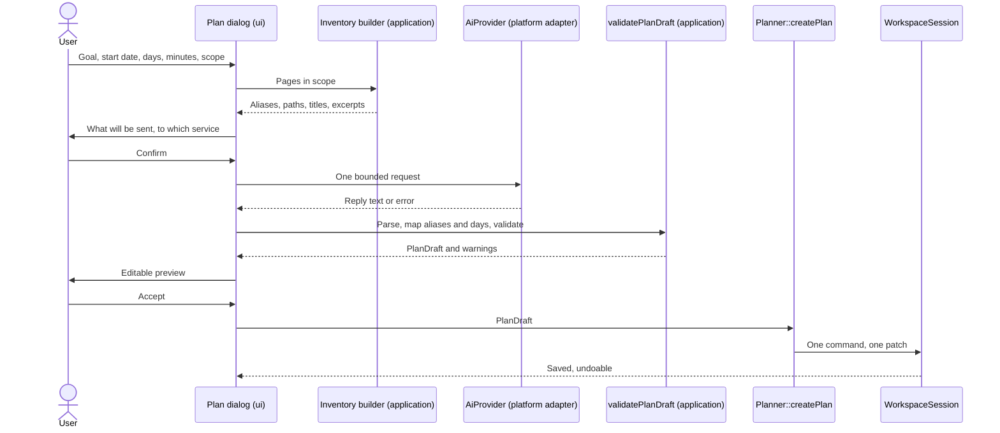

# StudyBoard 2.0 — Plan

> Status: **plan; the M1 decisions (P1–P4, P8, O4) were approved in principle on
> 2026-10-14; 2.0-PLAN-01 is implemented, was accepted on 2026-10-14 (D57) and is merged
> into `dev/2.0`; 2.0-PLAN-02 is implemented on `feature/2.0-PLAN-02-task-estimates` and
> awaits review and integration; nothing else in it is implemented.**
> This is the canonical planning reference for StudyBoard 2.0. It consolidates and
> replaces the two working drafts "StudyBoard 2.0 — AI-Assisted Study Plans" (v1.1,
> 2026-10-12) and "StudyBoard — AI study plans (plan)" (§2.1). The short roadmap with
> status is [ROADMAP.md, Version 2.0](ROADMAP.md#version-20-not-started-dev20); accepted
> decisions are in [ARCHITECTURE.md §18](ARCHITECTURE.md#18-decision-log). Decisions here
> (P-numbers, §10) become D-numbers only once they are implemented and that implementation
> is approved.
>
> Written on `dev/2.0` at `e5777fd` (version 2.0.0-dev). Class and function names marked
> *(new)* do not exist yet; every other name is checked against that commit.

## 1. Product definition

StudyBoard is a **general-purpose digital study notebook that supports PDFs but does not
depend on them**. A writable page exists on its own; a user may optionally relate it to a
page of a PDF. Removing or replacing a PDF never deletes independent notebook work.

2.0 adds **study plans**: a goal broken into dated study blocks, each linked to the pages
to study, with the linked pages highlighted in the notebook tree when a block is selected.
An **optional, bounded AI assistant** can propose such a plan, and later summarize or
explain selected material and help find real external resources.

> **Core rule:** the AI proposes; StudyBoard validates, previews, asks for approval,
> persists through its existing services and performs all navigation and highlighting.
> The AI cannot control the application.

The AI must not mutate application state, write to SQLite, drive widgets, run commands or
programs, read files, or silently create, change, move or delete anything. StudyBoard
stays fully useful without AI, without an API key and offline.

Out of scope for 2.0 (from both drafts): general chat, agent loops, multi-agent
orchestration, AI-driven shell or app actions, automatic unreviewed saving, model training
or hosting, OCR, handwriting recognition, image understanding, long-term AI memory,
autonomous rescheduling, payments.

## 2. Sources and how they were reconciled

### 2.1 The two drafts

| Draft | Character | What it contributed |
|---|---|---|
| **A** — "StudyBoard 2.0 — AI-Assisted Study Plans", v1.1, 2026-10-12 | Broad product proposal: boundaries, conceptual architecture and data model, flows, highlight rules, page/PDF independence, validation, operation list, resource discovery, privacy, milestones AI-01…AI-08, 20 acceptance criteria, 10 open questions, rules for coding agents | Product identity, scope boundaries, safety rules, resource discovery, the open questions |
| **B** — "StudyBoard — AI study plans (plan)", target "1.3" | Detailed plan fitted to the codebase: plans as existing study records, Gemini through the OpenAI-compatible endpoint with the user's own key, environment variable for the key, CMake flag `STUDYAPP_ENABLE_AI` (default OFF), three tasks 1.3-PLAN-01, 1.3-AI-01, 1.3-AI-02, response format, validation limits, error messages, privacy text, 14 acceptance items, proposed D56/D57 | The concrete, testable first steps, limits and response schema |

B says it replaces A, but B narrows A rather than covering it: A's page/PDF links,
two-page study, revision, summarize/explain and resource discovery are absent from B or
listed under "Later". Both are kept here; where they conflict, the codebase decides (§3).

### 2.2 Reconciliation

| Topic | A | B | This plan | Status |
|---|---|---|---|---|
| AI only proposes; app validates, previews, persists, navigates | ✔ | ✔ | Kept (§1) | Agreed |
| Plans reference pages, never copy them; highlight is derived UI state | ✔ | ✔ | Kept (§5) | Agreed; verified against the code (§3.2) |
| Fake providers, fixtures, no network or real key in tests | ✔ | ✔ | Kept (§8) | Agreed |
| No secrets in logs, crash output, repo, workspace, ordinary settings | ✔ | ✔ | Kept (§7.4) | Agreed |
| App works with AI off, no key, offline | ✔ | ✔ | Kept; acceptance item in every AI task | Agreed |
| PDF/web text and model output are untrusted data | ✔ | ✔ | Kept (§7.6) | Agreed |
| Task IDs | `AI-01`…`AI-08` | `1.3-PLAN-01`, `1.3-AI-01/02` | `2.0-<AREA>-NN` (§4.1); old IDs kept in a traceability column | Approved (P1) |
| Provider | Choose one after evaluation | Gemini, OpenAI-compatible endpoint, user's free key | One OpenAI-compatible adapter; Gemini as the **development** preset; release provider decided at the release gate (§7.1) | **Needs approval** (P6, O1) |
| Key storage | OS credential store where practical | Env var now; OS keychain before a public release | Same as B for development; keychain (or no AI in packages) before release (§7.3) | Proposed (P7) |
| AI in the default build | — | No: `STUDYAPP_ENABLE_AI` OFF | Kept (§7.2) | Proposed (P5) |
| Plan storage | Conceptual new entities, "map onto the actual model" | Existing `project` / `task` / `task_page`, no migration | B's mapping, verified: no migration needed (§3.2) | Approved (P3) |
| One undoable save | — | `Planner::createPlan` as one patch | Feasible; needs a new pure command (§3.2, 2.0-PLAN-03) | Approved (P4) |
| Deleted/"trashed" linked pages | Mark reference unavailable | "Trashed pages are skipped" | **There is no Trash**: deleting a page unlinks it from tasks in the same undoable patch (§3.2). "Unavailable" applies only to PDF assets (§3.3) | Corrected by code |
| Page ↔ PDF page link | In scope (§7 of A) | Out ("a separate feature") | Separate, later task 2.0-SRC-01 with a schema migration | Deferred; **needs approval** (O5) |
| Two-page study workspace | — (not in either draft) | — | Evaluated (§6.2), separate later task 2.0-WS-01 | Deferred; new |
| Scope of the first AI version | All five operations as milestones | `generate_plan` only | `generate_plan` first; others later, in order of value (§4) | Proposed |
| Summarize / explain | AI-02 (second milestone) | Later | After plan generation (2.0-AI-05) | Proposed (O7) |
| Plan revision | AI-06 "reviewable" | Later ("send the plan back, preview the difference") | Manual editing first (2.0-PLAN-02), AI revision later (2.0-AI-04) | Proposed |
| Resource discovery | AI-07, real retrieval provider | Later; OpenAlex, Crossref, arXiv, Open Library | 2.0-RES-01 without AI; AI relevance notes optional later | Deferred (O8) |
| Console entry point | — | `plan generate "<goal>" --days 7 --minutes 120` | Optional, after the dialog exists; option syntax is new to the console (§6.4) | **Needs approval** (O6) |
| Numeric limits | "Appropriate limits" (open question 9) | 64 KiB / 256 KiB / 60 s / 60 pages / 300 chars / 5–480 min / 12 per day / 100 | Kept as initial values with reasons, re-checked against measurements in 2.0-AI-02/03 (§7.5) | Proposed |
| Error texts | — | Gemini-specific, including "limits reset at midnight Pacific time" | Provider-neutral categories; no hard-coded reset times; provider message in details (§7.5) | Changed |
| Decision numbers | — | D56, D57 | **D56 is taken** (batch export). Decisions are P-numbers until implemented and approved (§10) | Corrected |
| Revision questions / flashcards | Open question 10 | — | Deferred (§11) | Deferred |
| A non-AI way to make a plan | — | — | **New:** 2.0-PLAN-03 builds a plan from a chosen scope without AI, through the same preview and save the AI will use | Approved (P2) |

## 3. Repository findings (verified at `e5777fd`)

### 3.1 State

* `dev/2.0` at `e5777fd`, level with `origin/dev/2.0`; `kVersion` `2.0.0-dev`. CI and
  Package for that commit: success (runs 38485079833, 38485079811).
* No 2.0 feature is implemented. The 2.0 section of ROADMAP.md held two follow-ups moved
  from 1.2 (1.2-CMD-02, 1.2-PDF-03); they keep their IDs.
* Modules (ARCHITECTURE.md §2, enforced by `tools/check_boundaries.py`): Qt-free `core`,
  `document`, `study`, `render`, `canvas`, `persistence`, `application`, `ipc`; Qt
  `render_gl`, `platform`, `ui`; `app`.

### 3.2 Study records, edits, undo — what a plan can reuse

| Fact | Where |
|---|---|
| `study::Project` {title, description, status, course, start, due, order, …} and `study::Task` {title, notes, status, priority, course, project, parent, dueDate, dueTime, scheduled, **estimate**, **linkedPages**, tags, order, completed} | `src/study/include/studyapp/study/Records.hpp` |
| Stored in schema v1: `project`, `task`, `task_page(task_id, page_id)` with `ON DELETE CASCADE` | `src/persistence/migrations/0001_initial.sql` |
| Every edit is `Command{label, Patch}`; a `Patch` is an ordered list of changes of any record kind (`AnyChange` includes `ProjectChange`, `TaskChange`), applied atomically and undone as one step | `document/Patch.hpp`, ARCHITECTURE.md D42 |
| `application::Planner` runs one command per operation; `setPageTagNames` already merges tag creation and the update into one patch | `application/Planner.hpp`, `Planner.cpp` |
| Large single-patch commands exist ("Import notebook", "Import PDF") | `WorkspaceSession.hpp` |
| Task creation appends after the last sibling (`FractionalIndex::after`) and is computed from the *current* workspace, so N independent `createTask` commands composed into one patch would get the same key | `document/StudyCommands.hpp`, `core/FractionalIndex.hpp` |
| Deleting a page removes it from every task's `linkedPages` in the same patch (`appendTaskUnlinks`); undo restores both | `StudyCommands.hpp`, DATA_MODEL.md §5 |
| **No Trash**: deletes are hard and undoable (D38); a workspace with trashed rows is refused | DATA_MODEL.md §3, `CatalogStore.cpp` |
| `Workspace::tasksLinkedTo(page)` backlinks, O(1) maintained | DATA_MODEL.md §5 |
| Planner panel: agenda, tasks by course/project, week, page view; task editor with title, status, due date/time, time block, notes, linked pages ("Link open page"), tags. **No editor for `estimate`** | `ui/src/PlannerPanel.cpp` |
| Agenda lists every open task with a due date; a 7-day plan of 14 tasks adds 14 entries | `study/Planning.hpp` |

**Conclusion.** A plan is a `Project` (title = goal, `start`, `due` = last day,
`description`), each study block a `Task` (`project`, `title`, `notes` = objective,
`dueDate`, `estimate`, `linkedPages`, order). **No schema migration is needed.** One
undoable save needs one new pure command that creates the project and all tasks with
consecutive order keys (2.0-PLAN-03). Undo, persistence, search (tasks are indexed) and
the Planner panel then work unchanged.

What the records cannot express without a migration: a link from a task to a *PDF page*
that is not a workspace page (none exist — see §3.3), a link to a section or notebook, a
per-link "unavailable" state, and a plan-level type marker (a plan is an ordinary project;
P3 accepts this).

### 3.3 Pages and PDFs

| Fact | Where |
|---|---|
| Hierarchy Notebook → Section → Page → Layer → Element; ids are UUIDv7 | DATA_MODEL.md §3 |
| A page without a document is an ordinary writable page (bounded or infinite) | `PageInfo` in `document/Records.hpp` |
| **An imported PDF page is itself a notebook page**: `PageInfo::document = PageDocument{asset, index}` draws PDF page `index` of a content-addressed asset behind the page's own elements (annotations). `import pdf` makes one section with one page per PDF page | D44, `PdfTextSearch.hpp` (`PdfSource`) |
| There is **no PDF document entity** in the tree and no link from a page to *another* page's PDF source | Records, schema |
| A missing asset file is reported by Check Workspace; the page and its elements stay | DATABASE_SCHEMA.md §3 |
| Older versions refuse a workspace with a newer schema version ("created by a newer version") | `persistence/src/Migrations.cpp` |

So: independent writable pages **exist**; "a PDF page in the tree" means a page with a
PDF background; a task can already link such a page; removing the PDF *section* deletes
those pages (undoable) and unlinks them from tasks; the user's other pages are untouched.
An optional link from a writable page to a PDF page **does not exist** and needs a schema
migration, which makes 2.0 workspaces unreadable by 1.x (2.0-SRC-01, O5).

### 3.4 Shell, navigation, tree, console

| Fact | Where |
|---|---|
| One `CanvasWidget`, one `canvas::CanvasController` over a `SessionDocumentPort`, in a horizontal `QSplitter` with the navigation panel | `MainWindow.cpp`, `MainWindowWorkspace.hpp` |
| One patch listener on the session; `MainWindow::onPatchApplied` fans out to controller, tree, navigator, planner | `MainWindow.cpp` |
| `application::PageNavigator`: one active page, kept valid across deletes/undo; previous/next page | `PageNavigator.hpp` |
| One undo history per workspace; undo of an edit on another page first opens that page (D36) | ARCHITECTURE.md §3.5 |
| `ui::WorkspaceTreeModel` roles `KindRole`, `ActiveRole` (shown bold through `Qt::FontRole`); no item delegate | `WorkspaceTreeModel.hpp/.cpp` |
| Design tokens: neutral surfaces, `hover`, `selected`, `borderStrong`, text levels, status colours only for status | `ui/DesignTokens.hpp`, ARCHITECTURE.md §3.3 |
| Command console: registry of named commands with positional arguments; calls the window's existing operations; no OS commands, no scripting; long work on a pool thread with `cancel` | COMMAND_CONSOLE.md §3, §8, §10 |
| `application::search(session, text, limit)` ranks pages, text boxes, tasks | `application/Search.hpp` |
| PDF text: extracted only by the isolated worker (D53, D55), cached per asset in `PdfTextCache` (32 MiB, 64 entries) for the session | `PdfTextSearch.hpp` |
| App settings in `QSettings` (window state, tools); workspace settings in the workspace's `setting` table, which is bundled and backed up | `MainWindow.cpp`, `0001_initial.sql` |

### 3.5 Networking, threading, build

* **No networking**: Qt components are Core, Gui, Widgets, OpenGL, OpenGLWidgets, Pdf,
  PrintSupport, Svg (+Test); no QtNetwork, no TLS backend or plugin is deployed
  (`cmake/Dependencies.cmake`).
* Threading (ARCHITECTURE.md §10.1): domain, SQLite, GL on the GUI thread; worker threads
  only for measured stalls, each owning plain data; cancellation by stop flag.
  `QNetworkAccessManager` is asynchronous on the GUI thread and fits this model.
* CMake options: `STUDYAPP_BUILD_APP`, `_TESTS`, `_WARNINGS_AS_ERRORS`,
  `_ENABLE_PROFILING`, `_BUILD_BENCHMARKS`, `_USE_SYSTEM_SQLITE`,
  `_DEPLOY_QT_TO_BUILD_TREE`. No AI option yet.
* Documentation checks: `tools/check_markdown_links.py` (CI); no Markdown linter or
  Mermaid renderer in the repository.

### 3.6 External services (checked 2026-10-14 on the providers' own pages)

| Service | Verified facts | Consequence |
|---|---|---|
| Gemini API, OpenAI-compatible endpoint | Base URL `https://generativelanguage.googleapis.com/v1beta/openai/`, key as `Authorization: Bearer`; JSON structured output supported; model list supported; "Support for the OpenAI libraries is still in beta" | One adapter can serve Gemini and other compatible services; the beta status needs recorded fixtures and a fallback plan |
| Gemini API terms, unpaid services | Google uses submitted content and responses to improve its products; **human reviewers may read** input and output; "Do not submit sensitive, confidential, or personal information"; users must be 18+; **apps made available to users in the EEA, Switzerland or the UK may use only paid services** | The free tier is acceptable for the author's own development; it cannot be the unexamined default of a public release (O1) |
| Gemini rate limits | RPM, TPM and RPD; numbers are shown in AI Studio, not published; RPD resets at midnight Pacific time | No quota numbers or reset times in StudyBoard's messages; show the provider's error text |
| OpenAlex | No key for basic queries (first page only without a key); 10 requests/s keyless; daily budget in response headers, reset at midnight UTC | Usable keyless for small searches |
| Crossref REST | No sign-up; "polite pool" with `mailto`; metadata mostly not under copyright, some abstracts may be | Usable; needs a contact address policy |
| arXiv API | ≤ 1 request per 3 s, one connection; metadata CC0; no implied endorsement | Usable with strict client-side pacing |
| Open Library | 1 req/s anonymous, 3 req/s with a `User-Agent` naming the app and a contact; no bulk use | Usable for books with an identifying User-Agent |

## 4. Roadmap

### 4.1 Task IDs

`2.0-<AREA>-<NN>`, as `2.0-REL-01`: `PLAN` study planning (no AI), `AI` assistant
operations and provider, `SRC` page ↔ PDF source links, `WS` study workspace, `RES`
resource discovery, `REL` release work. Feature branches are
`feature/2.0-<AREA>-<NN>-<slug>` from `dev/2.0` (the guard enforces this pattern). The
1.2 follow-ups moved to 2.0 keep their IDs (1.2-CMD-02, 1.2-PDF-03).

| This plan | Draft A | Draft B |
|---|---|---|
| 2.0-PLAN-01 | AI-05 (non-AI part) | 1.3-PLAN-01 |
| 2.0-PLAN-02 | AI-06 (manual part) | — |
| 2.0-PLAN-03 | AI-03, AI-04 (non-AI part) | 1.3-AI-02 (`createPlan`, preview) |
| 2.0-AI-01, 2.0-AI-02 | AI-01 | 1.3-AI-01 |
| 2.0-AI-03 | AI-04 | 1.3-AI-02 |
| 2.0-AI-04 | AI-06 (revision) | §8 "revise plan" |
| 2.0-AI-05 | AI-02 | §8 "summarize/explain" |
| 2.0-RES-01, 2.0-AI-06 | AI-07 | §8 "find resources" |
| 2.0-REL-02 | AI-08 | §8 keychain, AI in packages |
| 2.0-SRC-01 | §7 page/PDF link | out of scope |
| 2.0-WS-01 | — | — |

### 4.2 Milestones and dependencies

| Milestone | Tasks | Outcome | Depends on |
|---|---|---|---|
| **M1 — Study plans without AI** (first usable milestone) | 2.0-PLAN-01, 2.0-PLAN-02, 2.0-PLAN-03 | Make a plan from chosen sections, edit it, see its pages highlighted | — |
| **M2 — AI foundation** (development builds only) | 2.0-AI-01, 2.0-AI-02 | A provider port, fake provider, one network adapter behind `STUDYAPP_ENABLE_AI` | P5, P6 approved |
| **M3 — AI study plans** (development builds only) | 2.0-AI-03 | The AI proposes the plan that M1's preview shows and saves | M1 (PLAN-03), M2 |
| **M4 — Later study tools** | 2.0-AI-04, 2.0-AI-05, 2.0-RES-01, 2.0-AI-06 | Revision, summarize/explain, real resources | M3 (AI-04, AI-06), M2 (AI-05), — (RES-01) |
| **M5 — Pages and PDFs** | 2.0-SRC-01, 2.0-WS-01 | Link a page to a PDF page; source and notes side by side | O5, O9 approved |
| **M6 — Release readiness** | 2.0-REL-02 (+ the release task) | Decide what ships, harden, document | The features chosen for 2.0.0 |
| Carried from 1.2 | 1.2-CMD-02, 1.2-PDF-03 | PDF match highlight; persisted PDF text index | Independent |

**Order and parallelism.** M1 first: it delivers value with no network, no new dependency
and no migration, and it builds the preview and the one-patch save that M3 reuses, so
nothing is wasted if the AI part is dropped. 2.0-PLAN-01 and 2.0-PLAN-02 are independent of
each other. 2.0-AI-01 depends on nothing in M1 and can run in parallel once P5–P7 are
approved; 2.0-AI-03 waits for both lines. One task is active at a time in the current
three-agent workflow; "parallel" means the order may be swapped, not concurrent branches,
unless the user decides otherwise. M5 is independent of the AI and is sequenced after M3
by value, not by dependency.

### 4.3 Status key

Every task below carries a status line: **implemented** (with evidence), **investigate**
(open technical questions before the task document), **proposed** (ready for a task
document once approved), **blocked** (needs a decision, named). Today two tasks are
implemented: 2.0-PLAN-01, accepted on 2026-10-14 (D57) and merged into `dev/2.0`; and
2.0-PLAN-02, on its feature branch, awaiting review and integration.

## 5. Milestone M1 — study plans without AI

### 2.0-PLAN-01 — Highlight a task's linked pages in the tree

* **Status:** implemented on `feature/2.0-PLAN-01-tree-highlight` and merged into `dev/2.0`
  as `9f3e2a1` (tree model, window wiring and markers; tests in
  [TESTING.md §0](TESTING.md#0-test-suites-10-12-and-20), "2.0 additions"), accepted on
  2026-10-14 as
  [D57](ARCHITECTURE.md#18-decision-log). The look (O4) costs every row 2 px of height
  and moves titles one marker width to the right, whether or not anything is marked
  (accepted by the user, 2026-10-14).
* **Branch:** `feature/2.0-PLAN-01-tree-highlight` from `dev/2.0`.
* **Goal / user-visible outcome:** selecting a task in the Planner panel marks its linked
  pages in the navigation tree, and their notebooks and sections as "contains a linked
  page", so the user sees where to study. Clicking a marked page opens it.
* **Scope:** a derived, never-stored highlight; switching tasks updates it; deselecting the
  task, hiding the Planner panel or Escape in the tree (which deselects the task) clears
  it; completing a task keeps its links and the highlight while it stays selected. Limited
  to: derived tree marks, accessible descriptions, theme-aware markers, the
  selection/hide/Escape behaviour, updates after every patch, and tests.
* **Non-goals:** highlighting PDF text; marking sections or notebooks as link targets
  (tasks link pages only); persisting the active task; plan generation, estimates or any
  other planner change; document, database or `application` changes; new colours; any AI.
* **Reuse:** `Task::linkedPages`; `PlannerPanel::selectedTask()`; `WorkspaceTreeModel`
  (`ActiveRole` pattern, targeted `dataChanged`); `PageNavigator::open`; the patch fan-out
  in `MainWindow::onPatchApplied`; `DesignTokens`.
* **Architectural change:** `WorkspaceTreeModel` gains a highlight set (pages) and a role
  *(new: `LinkedRole`, plus `ContainsLinkedRole` for ancestors)* set by the window from the
  planner's selected task and refreshed on every patch (a link change, a deleted page, an
  undo). `PlannerPanel` gains a selection-changed notification *(new)*. Drawing (O4):
  `Qt::DecorationRole` icons, no item delegate — see O4 in §11.
* **Likely files (provisional):** `src/ui/src/WorkspaceTreeModel.{hpp,cpp}`,
  `PlannerPanel.{hpp,cpp}`, `MainWindow.cpp`, `ThemeIcons.{hpp,cpp}`,
  `tests/ui/ShellTest.cpp`, ARCHITECTURE.md §3.5 (description only), TESTING.md,
  ROADMAP.md (status).
* **Tests:** model roles with 0, 1 and many links; links across notebooks; ancestors
  marked; a linked page deleted (unlinked by the patch → no highlight, no crash) and
  restored by undo (highlight back); switching and clearing; a task completed keeps the
  highlight; a patch that moves a linked page keeps it highlighted at its new row; the
  shell: selection, current index, focus and the active page do not change when a
  highlight appears or disappears; clicking a highlighted page opens it; the highlight
  and the active page, the selection, hover and search results are distinguishable
  (role values and, where practical, a rendered-pixel check in the offscreen platform).
* **Acceptance:**
  1. Selecting a task with links marks exactly its linked pages and their ancestors.
  2. Selecting another task replaces the marks; deselecting or Escape clears them.
  3. A task without links marks nothing.
  4. Deleting a linked page removes its mark; undo brings both back.
  5. Marks never change the tree's selection, current item, expansion or the active page.
  6. Highlight, selection, active page, hover and search results look different in light
     and dark themes, without a new accent colour.
  7. Clicking a marked page opens it through `PageNavigator`.
  8. Nothing is persisted; reopening the workspace shows no marks.
* **Risks:** the tree shows no icons today, so markers change its look slightly; the
  markers must be rebuilt when the theme switches; screen-reader users rely on the
  accessible description, not the icon.
* **Done when:** acceptance 1–8 pass in CI on all three platforms; docs updated; reviewed.

### 2.0-PLAN-02 — Edit study blocks: estimate and plan totals

* **Status:** implemented on `feature/2.0-PLAN-02-task-estimates`, awaiting review and
  integration into `dev/2.0` (estimate editor, the estimate in every task list, a project's
  dates and totals; tests in [TESTING.md §0](TESTING.md#0-test-suites-10-12-and-20), "2.0
  additions"). The user's decisions during the task: an "Estimate" check box and minutes
  field (0–9,999, step 5) beside "Length", unchecked meaning no estimate; the estimate in
  all four lists; totals over a project's top-level tasks, Done counted, Cancelled not; the
  project's dates shown, not edited; the day lines scroll after about five lines with the
  Total line always shown, and while they scroll they are a Tab stop, marked by one
  stylesheet rule scoped to that area.
* **Goal:** a plan's blocks can be edited completely after saving. The `estimate` field
  exists in the model and the database but has no editor.
* **Scope:** an "Estimate (minutes)" field in the task editor; the estimate shown in task
  lists; in a project's task list, totals per due date and for the project. Existing
  editing (title, notes, due date, links, order with `moveTaskBy`, status) is reused.
* **Non-goals:** automatic rescheduling; per-plan daily limits stored anywhere (a daily
  limit is a property of the generation request, not stored — P3); new task statuses
  (Todo, InProgress, Done, Cancelled cover A's "not started, in progress, complete").
* **Reuse:** `Planner::updateTask`, `PlannerPanel` editor patterns (save on
  `editingFinished`), `study::checkValues` (estimate ≥ 0).
* **Likely files (provisional):** `src/ui/src/PlannerPanel.{hpp,cpp}`,
  `tests/ui/ShellTest.cpp` or `tests/application/PlannerTest.cpp`, DATA_MODEL.md §5
  ("the planner edits …" sentence).
* **Tests:** editing an estimate is one undoable, persisted edit; clearing it stores no
  estimate; totals for a project with mixed dates and missing estimates; read-only
  workspaces refuse the edit.
* **Acceptance:** an estimate can be set, changed and cleared; totals per day and per
  project are correct and update after every patch; undo/redo and reopen keep the value.
* **Done when:** acceptance passes; DATA_MODEL.md no longer says the field is unedited.

### 2.0-PLAN-03 — Make a study plan from a chosen scope (no AI)

* **Status:** approved in principle (P2, P3, P4); not started; follows 2.0-PLAN-02.
* **Goal:** Planner ▸ *New study plan…*: a goal, a start date, a number of days, minutes
  per day and the notebooks/sections to cover → StudyBoard spreads the chosen pages over
  the days in tree order by the distribution rules below → an **editable preview** →
  **Accept** saves the project and all its tasks as **one undoable edit**; **Cancel**
  saves nothing.
* **Why before AI:** it is useful on its own, and it builds every piece the AI step needs
  except the provider: the scope picker, the page inventory, the `PlanDraft` value
  *(new)*, its validation, the preview and the one-patch save. 2.0-AI-03 only replaces
  "spread in tree order" with "ask the provider".
* **Scope / architecture:**
  * `application` (Qt-free) *(new)*: `PlanRequest` {goal, start date, days, minutes per
    day, scope}; `PlanDraft` {title, blocks: day (1 … D, or *unscheduled* — only by
    overflow resolution (c), rule 4), title, objective, minutes, pages};
    `validatePlanDraft` (the rules of §7.5, used again by AI-03); `draftByTreeOrder`
    (deterministic split); `Planner::createPlan(PlanDraft, PlanRequest)`.
  * `document::commands` *(new)*: `createPlan` — creates one `Project` (title, `start`,
    `due` = start + D − 1 with D the plan's days after any resolution (a), `description` =
    goal) and its `Task`s with consecutive order keys in block order, `project` set,
    `estimate`, `notes` = objective, `linkedPages`, and `dueDate` = start + day − 1 for a
    scheduled block; a block kept *unscheduled* by resolution (c) gets **no `dueDate`**
    (and so no `dueTime` or time block) — in one `Command` ("Create study plan").
  * `ui` *(new)*: a plan dialog (request form, scope tree with check boxes, preview table:
    day, title, minutes, linked pages, per-day totals against minutes per day, warnings).
  * The plan is an ordinary project in the Planner panel (P3).
* **Non-goals:** AI; plan templates; recurring plans; a separate "plan" record type;
  linking sections or notebooks.
* **Distribution rules** (`draftByTreeOrder`; deterministic: the same workspace and request
  always give the same draft):
  1. *Inputs.* The pages of the chosen notebooks and sections in tree order (notebook,
     section, page); a page chosen twice (its notebook and its section) counts once; empty
     sections are skipped; pages with a PDF background count like any page. N pages, D days
     (1 … 60), M minutes per day (5 … 480), budget B = D × M. N = 0: no draft, "No pages
     in the chosen scope".
  2. *Minutes per page.* e = B ÷ N rounded down to a multiple of 5, then clamped to
     5 … M. So a single page always fits in an empty day, and **a page is never split**.
  3. *Placement* — one procedure, applied to the sections in order. A *block* is the pages
     of one section placed on one day. State: the current day d (starts at 1), the minutes
     r left on it (starts at M) and the number b of blocks on it (starts at 0). *Next day*
     means d ← d + 1, r ← M, b ← 0; the r minutes left behind stay **unused** and are shown
     for that day in the preview, never redistributed. For a section of k pages, C = k × e:
     * **Whole section (C ≤ M).** If C ≤ r and b < 12, the section becomes one block on day
       d (r ← r − C, b ← b + 1). Otherwise go to the next day first, then place it there as
       one block. A section that fits in a full day is never split.
     * **Split section (C > M).** Repeat until all its pages are placed: if b = 12 or
       r < e, go to the next day; then put the next m = min(pages left, ⌊r ÷ e⌋) pages, in
       page order, into one block on day d (r ← r − m × e, b ← b + 1). The blocks are titled
       "*Section* (part *i* of *n*)", n being the number of blocks the section needed.
     * **Pages are indivisible.** A page is placed only where all e of its minutes fit in r;
       if no whole page fits in the time left, that time stays unused and the page starts
       the next day. Because e ≤ M and a new day has b = 0, every page fits on an empty
       day, so the procedure always ends.
     * **The 12-blocks-per-day limit** is part of the same rule: a day with 12 blocks takes
       no more, whatever minutes it has left.
  4. *Overflow — more work than D days.* Placement simply continues on day D + 1, D + 2, …;
     nothing is clamped onto day D and **no page is dropped**. Blocks after day D are
     *overflow blocks*: the preview lists them in their own group, "Does not fit in D
     days", with the day they would need, and states the total ("needs 9 days, 7
     requested; 170 minutes over"). The plan is never presented as fitting when it does
     not. **Accept is disabled while overflow is unresolved**; the user resolves it
     explicitly by one of: (a) extend the plan to the days it needs, which sets D to that
     number and shows the new end date — offered only when it is at most 60 days; (b)
     change minutes per day or the scope and rebuild; (c) keep the overflow blocks in the
     plan as **unscheduled** blocks: they are saved as tasks with **no `dueDate`** (they
     appear in the agenda's "No date" group), while every block on days 1 … D keeps its
     calculated date and the project's `due` stays start + D − 1; (d) remove the overflow
     blocks — their pages go to "Excluded pages" (rule 6). Each choice is visible in the
     preview before Accept.
  5. *The 100-block limit.* It counts every block, overflow included. If the draft needs
     more than 100 blocks, no partial plan is offered and **no page is discarded**: the
     dialog keeps the goal, dates, minutes and the chosen scope exactly as entered; the
     preview shows the scope (sections and page counts), the number of blocks needed and
     "The scope needs N blocks; the limit is 100. Choose fewer notebooks or sections, or
     more minutes per day so that large sections are split less, then rebuild."; Accept
     stays disabled until a rebuilt draft is within the limit.
  6. *Edits in the preview.* The user may change a block's minutes, day (1 … D; an
     unscheduled block may be given a day, which makes it an ordinary scheduled block),
     title or pages and remove blocks. A day over M minutes is a warning the user may keep
     (an informed choice, saved as entered); moving a block onto a day that has 12 blocks is
     refused with a message. **Removing a block** moves its pages to an **"Excluded pages"**
     list in the preview, grouped by section, visible before Accept, with *Restore* per
     block; the summary line says how many pages are excluded. Overflow resolution (d) uses
     the same list. Accept saves a plan without the excluded pages only while that list is
     shown.
  7. *Workspace changes.* Every page reference in the draft is re-validated against the
     current workspace when the draft is built, after every patch applied while the dialog
     is open (edits, undo, redo), and immediately before Accept saves. A reference is
     **invalid** when its page no longer exists, and **changed** when its page has moved
     outside the chosen scope. Invalid and changed references are listed in the preview
     with their blocks, and **Accept is disabled until the user resolves them** by
     rebuilding the draft from the current workspace, or by explicitly removing the
     listed references (their pages then appear under "Excluded pages", where they still
     exist) or keeping the moved pages. Nothing is removed or changed without that action.
     If the final check before saving still finds an invalid reference, nothing is saved
     and the preview shows why; `Workspace::apply` would refuse it anyway, so a save is
     never partial. A read-only workspace allows the preview but not Accept. A scheduled
     block's day *d* becomes the date start + *d* − 1 locally; an unscheduled block gets no
     date; a start date whose last day would not be storable is rejected in the form.
* **Tests:** `draftByTreeOrder` (empty scope, one page, more pages than days, more days than
  pages, PDF sections, mixed scope, a section exactly filling the remaining time, a section
  that fits a full day but not the rest of today, a section larger than a day starting
  mid-day and on an empty day, r smaller than one page, the 13th block of a day for a whole
  and for a split section, overflow by one block and by several days, N × 5 > B, more than
  100 blocks, a page chosen twice, determinism, no page in two blocks); each overflow
  resolution (a)–(d), including (a) not offered beyond 60 days and (c) saving the overflow
  tasks without `dueDate` while the scheduled tasks keep their dates and the project keeps
  `due` = start + D − 1 (also after undo/redo and reopen; the agenda lists them under "No
  date"); the 100-block case keeps every input; removing and restoring a block; a linked
  page deleted, undone and moved out of scope while the dialog is open (Accept disabled
  until resolved; nothing saved meanwhile); `validatePlanDraft` every rule; `createPlan` is
  one undo step (undo removes project and every task; redo restores them with the same ids;
  reopen restores them; order keys strictly increasing; search finds the tasks); the dialog
  in the shell with scripted input (accept, cancel, edit, over-limit warning, read-only
  workspace refuses).
* **Acceptance:**
  1. A plan is saved only after Accept, as one undoable edit, and survives reopening.
  2. Every saved link is an existing page from the chosen scope.
  3. Scheduled blocks' days become dates locally; a day over its minutes is shown as a
     warning and saved only if the user keeps it.
  4. Cancel and closing the dialog save nothing.
  5. No page is split across blocks or days; every page of the scope is in the preview,
     either placed, in the overflow group, or under "Excluded pages" by an explicit user
     action, which the preview shows before Accept.
  6. With overflow, Accept stays disabled until the user picks one of the resolutions;
     the plan is never shown as fitting in D days when it does not.
  7. A scope needing more than 100 blocks saves nothing, keeps every input and says how to
     reduce the scope or rebuild.
  8. Deleted pages and pages moved out of scope are reported, and Accept stays disabled
     until the user resolves them; no reference is dropped or changed silently.
  9. With resolution (c), the overflow blocks are saved as tasks without a `dueDate`, every
     other task keeps its calculated date, and the project's `due` is start + D − 1.
  10. The saved plan appears in the Planner panel as a project with its tasks; scheduled
      tasks appear in the agenda by due date and unscheduled ones in its "No date" group;
      2.0-PLAN-01 highlights their pages.
* **Risks:** agenda flooding (a plan adds one open task per block; acceptable, as they are
  real study blocks; revisit if users object); large scopes (the preview must stay usable
  at, say, 500 pages — measured in the task).
* **Done when:** acceptance passes; DATA_MODEL.md §5 documents the plan mapping;
  ARCHITECTURE.md gets the D-number of P3/P4 only after the implementation is completed and
  approved.

## 6. Milestones M2–M5

### 6.1 M2 — AI foundation (development builds only)

#### 2.0-AI-01 — Provider port, request lifecycle, fake provider

* **Status:** proposed. **Blocked by:** P5, P6.
* **Goal:** the code that talks to "an AI" without any network: a narrow port, value types,
  the OpenAI-compatible JSON, error mapping, and a fake provider for tests. Nothing is
  user-visible yet.
* **Architecture *(new)*:** in `application` (Qt-free), as its other ports (`Executor`,
  `PageExporter`, `DocumentInspector`): `AiRequest` {operation, system text, user data,
  max output tokens, JSON mode}, `AiReply` {text, input/output tokens}, `AiError`
  {category, provider message}, port `AiProvider` {`send(request, callback)`, `cancel()`,
  `testConnection(callback)`}; `encodeChatRequest` / `decodeChatReply` for the
  OpenAI-compatible chat-completions format with size limits; `FakeAiProvider` (scripted
  replies, delays, errors) under `tests/support`. A separate `ai` module (draft B) is not
  needed: the port belongs where its users are (P6).
* **Tests:** encoding (escaping, limits, JSON mode flag); decoding (good, missing fields,
  wrong types, not JSON, empty choices, oversized, truncated `finish_reason`, usage
  absent); every error category from recorded HTTP bodies; cancel before and after the
  reply; one request at a time per operation.
* **Acceptance:** builds and tests in every CI configuration including `core-only`; no Qt,
  no network, no key involved.

#### 2.0-AI-02 — Network adapter, settings, key, build flag

* **Status:** proposed. **Blocked by:** P5, P6, P7; investigate TLS deployment.
* **Goal:** with `-DSTUDYAPP_ENABLE_AI=ON`, Settings ▸ AI shows provider preset (base URL,
  model, editable), "AI enabled", key status ("found in `STUDYBOARD_AI_API_KEY`" /
  "missing" — name per O2), **Test connection**, and the privacy notice (§7.4).
* **Architecture *(new)*:** `platform::OpenAiCompatibleProvider` over
  `QNetworkAccessManager` on the GUI thread (asynchronous, `QNetworkReply::abort` for
  cancel, a transfer timeout); `Qt6::Network` found and linked only when the option is ON;
  TLS backend check per platform (Windows schannel, macOS SecureTransport/OpenSSL per Qt
  build, Linux OpenSSL 3 from the system in the AppImage) and the deployed `tls` plugin;
  app settings in `QSettings` (never the key, never the workspace).
* **Investigate first:** which Qt TLS plugins `windeployqt`/`macdeployqt`/linuxdeploy copy
  for the kit in `docs/BUILDING.md`; whether the AppImage may rely on the system OpenSSL
  3; the size cost of QtNetwork in each package.
* **Test connection** lists the provider's models (OpenAI-compatible `GET …/models`), which
  spends no tokens; it reports the categories of §7.5.
* **Tests:** the adapter against a local `QTcpServer`-based fake HTTP server in the test
  (no internet): request headers (key only in `Authorization`), timeouts, abort, error
  bodies, oversized bodies; with the option OFF the build and packages are byte-for-byte
  free of QtNetwork (package file lists compared in CI); the key never appears in the
  log, `QSettings` or the workspace (log sink captured in tests).
* **Acceptance:** Test connection succeeds with a real key on the author's machine
  (manual, recorded); without a key nothing is sent and the page explains what to do;
  normal use is unchanged with AI off, no key or no network.

### 6.2 M3 — AI study plans

#### 2.0-AI-03 — The AI proposes the plan

* **Status:** proposed. **Blocked by:** 2.0-PLAN-03, 2.0-AI-02.
* **Goal:** in the 2.0-PLAN-03 dialog, *Propose with AI* sends the goal and a bounded
  inventory of the chosen pages and fills the same preview; Accept/Cancel are unchanged.
* **Flow:** (1) request form as PLAN-03; (2) inventory: pages in scope with an alias
  (`p1`, `p2`, …), section path, title and a short text excerpt (typed text boxes; PDF
  text from `PdfTextCache` only if already cached — no worker job is started for the
  prompt unless the user asks, O3); ink-only pages contribute their title; over the page
  limit, the best by `application::search` on the goal, then tree order; (3) one request:
  fixed system text, the user's goal and the inventory as data; (4) `decode` → JSON →
  `PlanDraft` with aliases mapped to `PageId`s locally and days to dates locally (the model
  never sees ids or dates); unmatched topics listed; (5) `validatePlanDraft`; (6) the
  preview; (7) Accept → `Planner::createPlan`.
* **Privacy:** the first request in a workspace session shows what will be sent (goal,
  titles and excerpts of N pages, to which provider) and needs confirmation (§7.4).
* **Tests:** every validation rule with fixed replies (good, unknown alias, duplicate
  alias, day out of range, minutes out of range, too many tasks, unknown fields, not JSON,
  empty, oversized); inventory building (scope, limit, text sources, ink-only pages,
  prompt-injection text kept as data); the dialog with `FakeAiProvider` (accept, cancel
  while waiting, error keeps the inputs, a second request replaces the first).
* **Acceptance:** draft B §7 items 1–6, 13, 14 and draft A §13 items 1–6, 13–16, 19;
  token usage shown after each request.
* **Optional:** console `plan generate …` opening the same dialog (O6).

### 6.3 M4 — later study tools

| Task | Goal | Key rules | Blocked by |
|---|---|---|---|
| 2.0-AI-04 Revise a plan | Send a saved plan (as aliases) and a change request; preview the **difference** (added, changed, removed blocks); Accept applies it as one undoable edit | Never reschedules on its own; the user's edits since generation are shown, not overwritten silently | AI-03 |
| 2.0-AI-05 Summarize / explain | Explain or summarize the selected text box, the open page's typed text, or the open PDF page's extracted text; result in a panel, never written into the page unless the user copies it | Input limit; unsupported content (ink only, scanned PDF) says so; source text is data; nothing sent without the disclosure | AI-02, O7 |
| 2.0-RES-01 Find resources | Search OpenAlex (papers), Crossref (works), arXiv (preprints), Open Library (books) for a topic; show title, authors, year, type, source service and the **returned** URL; opening a result is a user action | No AI; client-side pacing per service (§3.6); fixtures for tests; empty, rate-limited and malformed results handled | O8 |
| 2.0-AI-06 Relevance notes | Optional AI sentence per *retrieved* result, visibly marked as AI-written, beside the retrieved metadata | The AI never adds, edits or removes results or URLs | RES-01, AI-02 |

### 6.4 M5 — pages and PDFs

#### 2.0-SRC-01 — Link a writable page to a PDF page

* **Status:** investigate; **blocked by** O5 (migration and 1.x compatibility).
* **Goal:** "Link to source…" on any writable page records a PDF page (asset + page index)
  as its source; the page shows the link; following it opens the PDF page in the
  workspace (or in the study workspace, WS-01). A study task may link the notes page, the
  PDF page, or both (as today, by linking both pages).
* **Design questions:** target = an existing PDF-background *page* (no migration of the
  asset model, but deleting that PDF section deletes the target) or an *asset + index*
  (survives deletion of the PDF section; needs the asset kept — assets are never collected
  automatically, D49); storage = columns on `page` or a `page_source` table; the
  "unavailable" state when the asset file is missing or the target page is gone; bundles,
  backups and Check Workspace.
* **Compatibility:** schema v2 → 1.2.0 refuses 2.0 workspaces; the release notes and
  RELEASE.md must say so, or the link must be stored without a migration (e.g. in the
  workspace `setting` table — rejected in advance: not a supported place for document
  data).
* **Acceptance (draft):** removing or replacing the PDF never deletes or changes the
  writable page; its source shows "unavailable"; undo restores the link with the PDF.

#### 2.0-WS-01 — Study workspace: source beside notes

* **Status:** investigate; **blocked by** O9. Not coupled to AI or plans.
* **Goal:** two pages side by side — typically a PDF page and a writable notes page — each
  with its own camera, resizable, either closable.
* **Required design work (none exists today):** a second `CanvasWidget` and
  `CanvasController` (second GL context; shared rasterizer and image source); fan-out of
  patches to both; `PageNavigator` with a primary and a secondary page; which side the
  tree, Previous/Next, the console's `open` and search results act on (the focused side);
  undo rule D36 with two visible pages (an edit on either visible page needs no page
  switch); tree marks for two open pages; layout persisted per workspace as shell state in
  `QSettings` (never in the workspace, D37); keyboard: a shortcut to swap focus and to
  open the selected tree page on the other side; with no linked source, the second side
  is whatever page the user opens there.
* **Measured before committing:** frame time and memory with two canvases of PDF pages on
  the reference machines.
* **Dependencies:** SRC-01 only for "open this page's source on the other side".

### 6.5 Carried from 1.2

1.2-CMD-02 (PDF match highlight) and 1.2-PDF-03 (persisted PDF text index) are unchanged
and independent; 1.2-PDF-03 would also help AI-03/AI-05 (PDF excerpts without starting the
worker) and needs a schema migration (same O5 trade-off).

## 7. Cross-cutting design

### 7.1 Provider choice

| Option | For | Against |
|---|---|---|
| **Gemini free tier, user's own key, OpenAI-compatible endpoint** (draft B) | No cost to anyone; no relay server; structured JSON output; model list for a cheap connection test | Free-tier content may be used for product improvement and read by human reviewers; not permitted for apps made available to EEA/UK/Swiss users on unpaid services; endpoint compatibility is beta; quotas unpublished and changeable |
| Gemini paid / other paid APIs, user's key | Better data terms; regional availability | User must pay and set up billing |
| Local model (Ollama, LM Studio; OpenAI-compatible servers) | Nothing leaves the machine; free | Quality and speed depend on the user's hardware; setup |
| Author-funded key behind a relay | Simplest for users | Cost, abuse, a server to run; rejected by both drafts |

**Recommendation (P6):** build one adapter for the OpenAI-compatible chat-completions
format with configurable base URL and model. Use **Gemini (free key, the author's own) as
the development preset** for M2–M3. Decide the **release** default at 2.0-REL-02 (O1):
likely "no provider preset enabled by default; the user chooses a provider and enters its
key; local OpenAI-compatible servers are a first-class preset", with the provider's
data-use terms shown in the disclosure. Claude, native Gemini and other non-compatible
APIs need their own adapter and are not planned.

### 7.2 Build configuration

`STUDYAPP_ENABLE_AI` *(new)*, default **OFF**: QtNetwork is found and linked, and the AI
UI compiled, only when ON. Release packages stay without QtNetwork/TLS until O1 and
2.0-REL-02 decide otherwise. CI adds one configuration with the option ON (fake provider
and local test server only). The Qt-free parts of AI-01 build in every configuration.

### 7.3 Credentials

| Stage | Where the key lives | Never |
|---|---|---|
| Development (M2–M3) | Environment variable (name: O2), read at use, not cached to disk | `QSettings`, the workspace `setting` table, logs, crash output, bundles, backups, test fixtures, the repository |
| Before any public release with AI | OS credential store (Windows Credential Manager, macOS Keychain, Secret Service on Linux), e.g. through QtKeychain — a new dependency whose licence and packaging must be checked (O2); or AI is not in the packages | Plain text anywhere |

### 7.4 Privacy and disclosure

* Before the first request that sends content to a provider, in each workspace session:
  what is sent (goal; titles and excerpts of N named pages; or the selected text), to
  which service (base URL host), and the provider's data-use statement as configured in
  its preset — for the Gemini free tier: content may be used to improve Google's products
  and read by human reviewers; do not send sensitive information.
* Nothing outside the chosen scope is sent. The user can see the exact inventory
  (expandable list) before confirming.
* After each request: tokens used, from the reply.

### 7.5 Limits and errors (initial values)

| Limit | Initial value | Reason / check |
|---|---|---|
| Request body | ≤ 64 KiB | 60 pages × (title + path + 300-char excerpt) ≈ 30 KiB plus instructions; checked by an encoding test |
| Reply body | ≤ 256 KiB | 100 blocks of ≤ 650 bytes is ≈ 65 KiB; generous margin, still bounded |
| Pages in the inventory | ≤ 60, ranked | Keeps the request under the limit; revisit with measured token counts |
| Excerpt per page | ≤ 300 characters, cut at a character boundary | Enough to identify a topic |
| Days | 1 … 60 | A term-length plan; draft B gave no maximum |
| Minutes per block | 5 … 480 | Draft B; a block over 8 h is a data error |
| Blocks | ≤ 12 per day, ≤ 100 per plan | Draft B; keeps the preview usable. Exceeding them never drops content silently: the non-AI builder places by these limits (2.0-PLAN-03, rules 3–5) |
| Title / objective | ≤ 120 / ≤ 500 characters, trimmed with a warning | Draft B |
| Timeout | 60 s per request, cancellable at any time | To be measured in AI-02 with the development preset; configurable only if measurement shows a need |
| Concurrency | One AI request at a time per window; a new request cancels the old | No queue, no retries (quota) |

Validation outcomes (draft B §4, kept): the whole reply is rejected when it is not JSON,
lacks `title` or `days`, or is too large; unknown fields, unknown or duplicate aliases and
untitled blocks are dropped with a warning; out-of-range days, minutes and lengths are
rejected per block or clamped with a warning; over-limit days are warnings the user
resolves; a reply with more than 12 blocks on a day or 100 in all is shown with the excess
flagged, as overflow is in 2.0-PLAN-03 (rules 4–5), never cut silently; a plan without page
links is allowed and labelled.

Errors map to categories with one sentence each and the provider's own message in the
details; no quota numbers or reset times are stated by StudyBoard: no key; key rejected;
quota or rate limit reached ("try again later"); service unavailable in the user's
region or for the account; request refused or empty reply; timeout; no connection;
reply unusable (with the validation reason). User input and the open preview are kept in
every case. No automatic retries.

### 7.6 Untrusted data

PDF text, typed notes, web results and model output are data. The system text is fixed in
the code; user and page text go into the data part of the request; the reply is parsed as
JSON only; nothing in it is executed, opened or followed; links in a reply are never shown
as resources (only RES-01's retrieved URLs are).

### 7.7 Component boundaries

Draft A's conceptual components, mapped onto the code. Names marked *(new)* are proposals.

| Component (draft A) | In StudyBoard | Must not |
|---|---|---|
| Study Plan UI | Plan dialog *(new, `ui`)*, `PlannerPanel` | Call a provider directly; save anything not validated and accepted |
| Study Operation Controller | The dialog's request object *(new, `ui`)* driving one `AiProvider` request with cancel | Loop, retry on its own, or chain requests |
| Context Builder | Inventory builder *(new, `application`)* over `Workspace`, `application::search`, `PdfTextCache` | Read outside the chosen scope; start PDF worker jobs unasked (O3) |
| AI Provider Adapter | `AiProvider` port *(new, `application`)*, `OpenAiCompatibleProvider` *(new, `platform`)* | Touch the workspace, the database or widgets |
| Response/Reference Validator | `decodeChatReply`, `validatePlanDraft` *(new, `application`)* | Trust ids, dates or URLs from the reply |
| Existing application services | `application::Planner` (+ `createPlan` *(new)*), `WorkspaceSession`, `PageNavigator` | Delegate any decision to model output |
| Existing persistence | `WorkspaceSession` writes the one patch; no new tables for plans (P3) | Become a separate AI database |
| Search/Retrieval Adapter | Resource search *(new, 2.0-RES-01)* | Present anything not returned by the service as a resource |

Without AI (2.0-PLAN-03) the same diagram applies with `draftByTreeOrder` in place of the
inventory, confirmation and provider steps.

Example (draft A §6–§7): a 7-day discrete-maths plan becomes project "Discrete
mathematics exam" with blocks such as "Day 1: Propositional logic (120 min)" linked to the
pages *Propositions* and *Truth tables*; the pages are referenced, not copied. A proof
written on a blank page needs no PDF; if it answers an exercise on page 37 of a PDF, the
task may link both the proof page and the PDF page's workspace page today, and the proof
page may record page 37 as its source once 2.0-SRC-01 exists. Deleting the PDF section
never deletes the proof.

## 8. Testing and verification

* Every task: unit tests in the Qt-free modules where the logic lives; shell tests through
  `ShellDialogs` scripting in the offscreen platform; CI on Windows, Linux, macOS and ASan;
  the Package workflow for tasks that touch the build.
* No test uses the network beyond `localhost`, a real key, or real private study content.
  Recorded provider replies are reduced, anonymised fixtures checked into `tests/`.
* Documentation tasks run `python tools/check_markdown_links.py`.
* Manual checks recorded in the task document: a real provider request (AI-02, AI-03);
  light/dark rendering of the highlight (PLAN-01).

## 9. Workflow and handoff

Each task gets a task document under the existing three-agent workflow (planner, coder,
release engineer) with milestones, acceptance criteria and commands; a feature branch
`feature/2.0-<AREA>-<NN>-<slug>` from `dev/2.0`; milestone review and commit by the
release engineer; `--no-ff` merge into `dev/2.0` on the user's approval. Gates per task:
(1) scope approved, (2) branch created, (3) each milestone reviewed, (4) acceptance report,
(5) merge approved. Nothing here authorizes a branch, a commit, a tag or a release.

Rules carried from draft A §15: a task never interrupts another active task or changes
its acceptance criteria; no protected branch, tag or release changes without the user's
approval; no history rewriting or force-push; no credentials or real private study content
in tests; no new framework or dependency without documenting why the existing facilities
are insufficient (QtNetwork in 2.0-AI-02 and a keychain library in 2.0-REL-02 are the two
foreseen); no chatbot or agent loop as a shortcut; reports name changed files, commands,
test results and blockers, and never claim tests that did not run.

## 10. Decision log

Accepted decisions this plan builds on (unchanged): D20/D25/D36 one workspace undo history;
D37 shell state not persisted; D38 hard deletes; D42 study records in the document
`Workspace`; D44 PDF pages as pages with a PDF background; D53/D55 PDF text only through
the worker; D54 console rules.

| # | Proposal | Alternatives considered | Reason | Status |
|---|---|---|---|---|
| P1 | Task IDs `2.0-<AREA>-NN` with areas PLAN, AI, SRC, WS, RES, REL; old IDs traced in §4.1 | Keep `1.3-…`; A's `AI-NN` | Matches `2.0-REL-01` and the guard's branch pattern | Approved 2026-10-14; not yet applied to a task |
| P2 | A non-AI plan builder (2.0-PLAN-03) precedes AI generation and owns the preview and save | AI-only plan creation (both drafts) | Useful without AI; de-risks the AI step | Approved 2026-10-14; not implemented |
| P3 | A study plan is an ordinary `Project` with one `Task` per block (`estimate`, `dueDate`, `notes` = objective, `linkedPages`); no plan record type, no migration; the daily limit is not stored | New `study_plan` / `study_task` / reference tables (A's sketch) | Same undo, persistence, search, Planner UI; verified in §3.2 | Approved 2026-10-14; not implemented |
| P4 | `createPlan` is one new pure command assigning consecutive order keys, executed once (one undo step) | Composing N `createTask` commands (same order key); N separate edits | Correct ordering and one undo step | Approved 2026-10-14; not implemented |
| P5 | AI compiled only with `STUDYAPP_ENABLE_AI` (default OFF) until the release gate | AI always compiled, disabled at run time | Packages gain no QtNetwork/TLS until the feature is worth shipping | Open until the AI milestone |
| P6 | The AI port lives in `application` (Qt-free); one `platform` adapter for OpenAI-compatible chat completions; Gemini as the development preset | A new `ai` module (draft B); the native Gemini API; several adapters | Ports belong to their users (ARCHITECTURE.md §3); one adapter covers several services | Open until the AI milestone |
| P7 | Key from an environment variable during development; OS credential store, or no AI in packages, before a public release | Key in `QSettings`; key in the workspace | No plain-text secret on disk; the workspace is bundled and shared | Open until the AI milestone |
| P8 | Plan highlight is derived UI state in `WorkspaceTreeModel`, never stored | A stored "active plan" | Draft A and B agree; no document change | Accepted 2026-10-14 as D57 (2.0-PLAN-01) |

An approved decision gets the next free D-number in ARCHITECTURE.md §18 (D58 onwards; P8 is D57) only
after its implementation is completed and that implementation is approved; until then it
is recorded here only.

## 11. Decisions needed from the user

O4 is decided (2026-10-14). O1–O3 stay open until the AI milestone (M2–M3); O5 and O9 stay
open until the page/PDF-link and study-workspace investigations (M5).

| # | Question | Recommendation | Trade-off |
|---|---|---|---|
| O1 | Release provider and whether AI ships in 2.0.0 packages at all | Decide at 2.0-REL-02; build and test with the Gemini development preset meanwhile; for release prefer "user chooses provider, local servers first-class, no default cloud preset" | Free Gemini is zero-cost but has data-use, human-review and EEA/UK/CH restrictions |
| O2 | Key: variable name and the release store | `STUDYBOARD_AI_API_KEY` (provider-neutral) for development; QtKeychain evaluated in 2.0-REL-02 | A new dependency vs. no AI in packages |
| O3 | Send PDF text excerpts in the AI inventory? | Only text already cached; titles otherwise; a check box to include PDF excerpts (starts worker jobs) | More context vs. time and data sent |
| O4 | Look of the tree highlight | **Decided:** shape markers through `Qt::DecorationRole`, no item delegate — a **filled dot** on each linked page and a **ring** (a distinct, hollow marker) on each section and notebook that contains one; drawn in the existing `textSecondary` token and rebuilt when the theme switches; the accessible description adds ", linked to the selected task" or ", contains linked pages"; **no new accent colour** | Shape plus text, so it never depends on colour alone; distinct from the bold active page, the selection and hover backgrounds and the separate search-results list |
| O5 | Schema migrations in 2.0 (SRC-01, 1.2-PDF-03) | Allow one migration in 2.0, announced as "2.0 workspaces cannot be opened by 1.x"; group all 2.0 schema changes into it | Features vs. one-way compatibility |
| O6 | Console command for plans | Add `plan new` (opens the dialog) only after PLAN-03; no option syntax until the console grammar is extended deliberately | Keyboard access vs. console scope (COMMAND_CONSOLE.md §9) |
| O7 | Summarize/explain before or after AI plans | After (AI-05 after AI-03) | Simpler feature first vs. headline feature first |
| O8 | Resource services | OpenAlex + Open Library first (keyless), Crossref and arXiv after; identify StudyBoard by User-Agent with a project contact, no user e-mail | Coverage vs. pacing and terms |
| O9 | Is the two-page study workspace in 2.0? | Investigate in 2.0 (design + measurement), implement only if the design keeps D36/D37 intact | High value vs. the largest UI change of 2.0 |
| O10 | Revision questions / flashcards (A's open question 10) | Defer beyond 2.0 | — |

## 12. Deferred beyond 2.0 (unless re-decided)

Revision questions and flashcards; recurring plans; reminders; OCR and image
understanding; additional AI adapters (Claude, native Gemini); AI memory across
sessions; automatic rescheduling; linking tasks to sections or notebooks.

## 13. Coverage of the two drafts

**Draft A's open questions (§14)** — answered or turned into decisions:

| A § 14 | Answer here |
|---|---|
| 1. What can a task reference? | Pages only, including pages with a PDF background (§3.2); sections and notebooks deferred (§12) |
| 2. How are PDFs in the tree? | As a section of pages with a PDF background; no document entity (§3.3) |
| 3. Where do plans live? | Workspace-level, as a project among the study records (P3) |
| 4. Which ids and persistence? | `ProjectId`, `TaskId`, `PageId` (UUIDv7), patches through `WorkspaceSession` (§3.2) |
| 5. Highlight vs. selection/search | Separate derived role and a neutral marker (2.0-PLAN-01, O4) |
| 6. Smallest useful inventory | Alias, path, title, ≤ 300-character excerpt, ≤ 60 pages (§7.5) |
| 7. Provider pair | P6, O1, O8 |
| 8. User control over what is sent | Scope picker, visible inventory, confirmation (§7.4) |
| 9. Limits, timeout, concurrency | §7.5 |
| 10. Revision questions | Deferred (O10) |

**Acceptance criteria** — where each is checked:

| Draft A §13 | Draft B §7 | Task |
|---|---|---|
| 1, 2, 3, 5, 6 | 3, 4, 5 | 2.0-PLAN-03 (without AI), 2.0-AI-03 (with AI) |
| 4, 19 | 6 | 2.0-AI-03 (replies), 2.0-PLAN-01 (deleted pages) |
| 7–12 | 7–12 | 2.0-PLAN-01 |
| 13, 14 | 6 | 2.0-AI-03 |
| 15, 16 | 1, 2, 14 | 2.0-AI-01, 2.0-AI-02 (and every later AI task) |
| 17 | 13 | 2.0-AI-02, 2.0-REL-02 |
| 18 | — | 2.0-SRC-01 (today: deleting a PDF section never touches other pages, §3.3) |
| 20 | — | 2.0-RES-01, 2.0-AI-06 |

Every requirement of draft A §1–§16 and draft B §1–§9 is either kept above (sections
named in §2.2), corrected by the code (Trash, D56, PDF entity), changed with a reason
(error texts, provider, limits) or listed as a decision (§11) or deferral (§12). Draft A's
§15 rules for coding agents are the existing workflow rules (§9) and
the repository's release policy ([RELEASE.md](RELEASE.md#branches-and-tags)).
